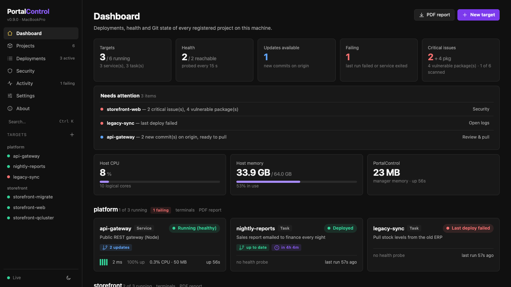
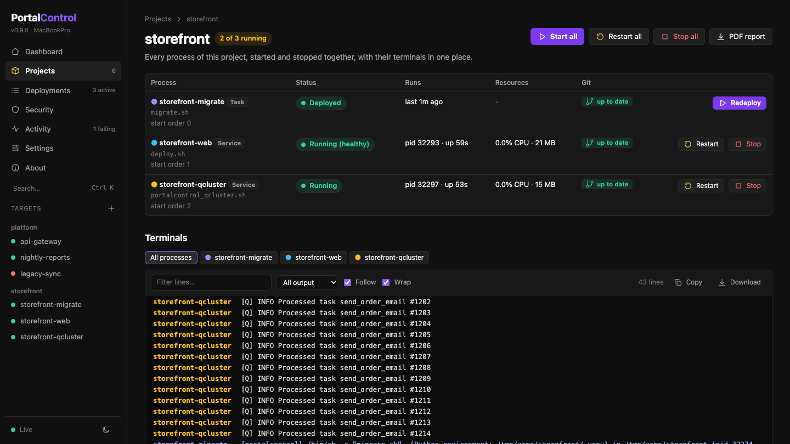
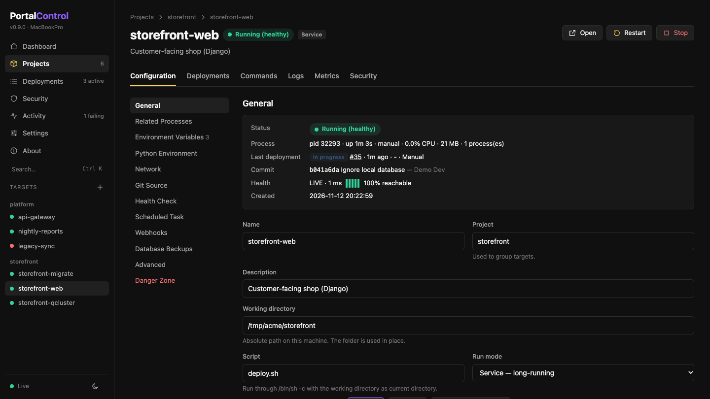
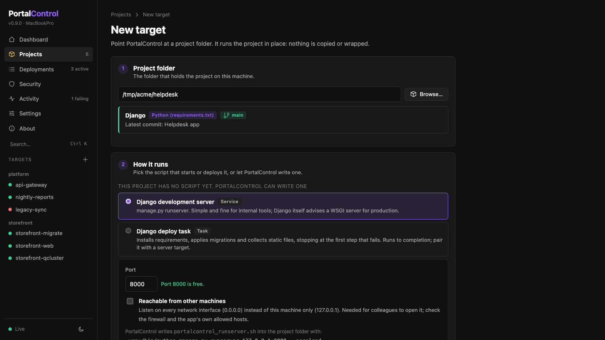
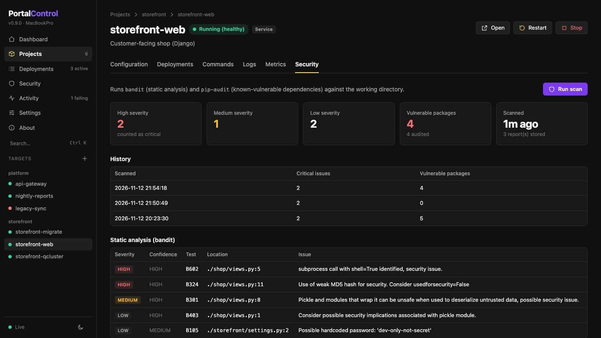
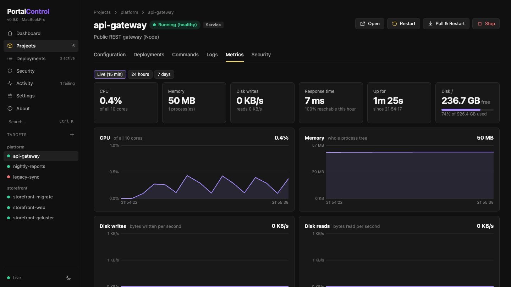
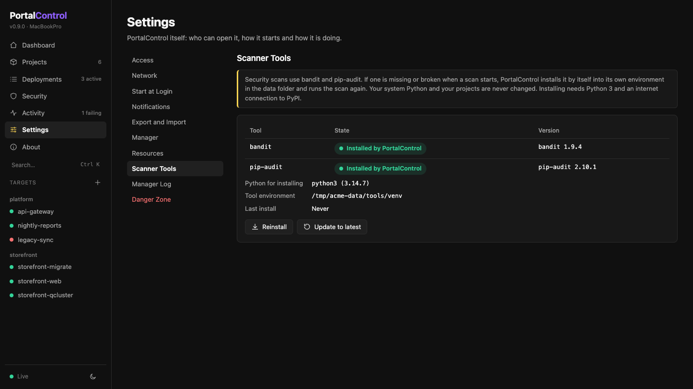
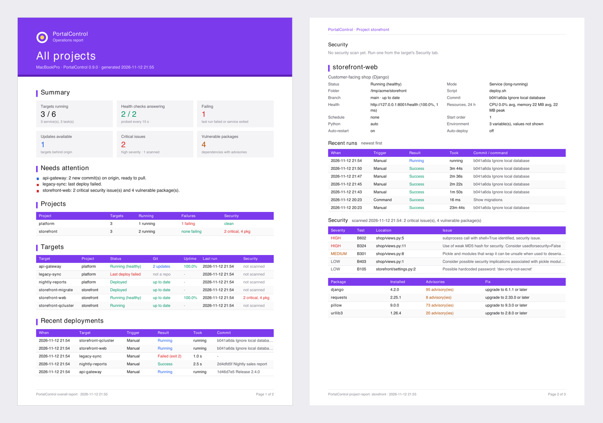

# PortalControl-Core

A native, single-binary automation supervisor written in Rust. It serves a local web
dashboard that tracks the Git state of your project folders, runs their deployment
scripts through the host's own shell (`cmd.exe /C` on Windows, `/bin/sh -c` on
macOS/Linux), streams the output live over WebSockets, probes application health and
runs security scans. It points at existing folders as they are: no Docker, no wrapping,
no changes to your project's files or databases.

Built from [`prd.md`](prd.md). The dashboard is laid out like a self-hosted deployment
panel: a sidebar, projects, and a page per target with Configuration, Deployments,
Logs, Metrics and Security tabs.



## Screenshots

*Taken from a demo setup: a Django shop with a web server, a migration task and a
Django-Q worker, a Node API gateway, a nightly report job and a job that fails on
purpose.*

<table>
  <tr>
    <td width="50%"><br><b>Project page.</b> Every process of a project, started in order, with one merged terminal.</td>
    <td width="50%"><br><b>Target page.</b> Live status, last deployment, checked-out commit and health history.</td>
  </tr>
  <tr>
    <td><br><b>New target.</b> Point it at a folder; it detects the framework, branch and a free port.</td>
    <td><br><b>Security scans.</b> bandit and pip-audit findings with scan history.</td>
  </tr>
  <tr>
    <td><br><b>Metrics.</b> CPU, memory, disk and response time of the whole process tree.</td>
    <td><br><b>Scanner tools.</b> Installed and repaired by PortalControl itself.</td>
  </tr>
</table>



*PDF reports: the overall report (left) and a page of a project report (right).*

## Dashboard at a glance

| Page | What it shows |
| --- | --- |
| Dashboard | Totals (running, reachable, updates available, failing, critical issues and vulnerable packages), a **Needs attention** list with a link to fix each item, host CPU and memory, target cards grouped by project with health uptime, recent deployments and activity, and the overall **PDF report** |
| Projects | Every target with status, Git state, health strip, last deployment and quick actions |
| Target → Configuration | General, Environment Variables, Git Source, Health Check, Scheduled Task, Webhooks, Advanced, Danger Zone |
| Target → Deployments | Every run with trigger, commit, duration and exit code; click one for its full log |
| Project page | The processes of one project with Start / Restart / Stop all and their terminals grouped |
| Target → Commands | One-click maintenance commands (migrate, collectstatic, pip install …) |
| Target → Logs | Live output with filter, stream selector, follow, wrap, copy and download |
| Target → Metrics | CPU and memory of the whole process tree, health response time, run durations |
| Target → Security | bandit and pip-audit findings, with scan history; missing scanner tools are installed automatically |
| Deployments / Security / Activity | The same information across all targets, plus an event feed |
| Settings | Start at login, manager details, resource charts, scanner tools, the manager's own log, shutdown |

## Projects with several processes

A project is often more than one process: a web server plus a queue cluster or
workers. Each process is its own target (own logs, health, metrics and restart
policy), and targets that share a **project** name belong together:

- The **project page** (click a project name) lists its processes, has *Start all*,
  *Restart all* and *Stop all*, and shows their **terminals together**: one merged,
  colour-labelled stream plus a tab per process.
- For Django projects PortalControl recognises **Django-Q** (`django_q` in settings or
  requirements → `manage.py qcluster`) and **Celery** (a `celery.py` next to
  `settings.py` → worker, plus beat when a beat schedule is configured). They are
  offered as tick boxes on *New target* and under *Configuration → Related Processes*.
  For Node projects the `start`, `dev` and `worker` scripts of `package.json` are
  offered the same way.
- Adding one registers a second service in the same project with restart-on-crash
  on. If no launcher exists yet, a small script (`portalcontrol_qcluster.bat` / `.sh`)
  is created in the project folder; it only runs the detected command, uses the
  project's own virtualenv when there is one, and an existing file is never
  overwritten. This is the one case where PortalControl writes into a project folder.
- Any other kind of process can be added by hand: create a script for it and register
  it as a target with the same project name.

## Password protection

By default there is no login, which suits a single-user machine on `127.0.0.1`. Under
*Settings → Access* you can set a password; from then on the dashboard, its API and the
live stream all require signing in.

- The password is stored only as a salted PBKDF2-HMAC-SHA256 hash.
- Sessions last 7 days, are held in memory (so everyone signs in again after a
  restart), and all end when the password changes.
- Five wrong passwords from one computer lock sign-in for that computer for a minute;
  others can still sign in (thirty from everyone together lock it for all).
- Deploy webhooks keep working: the token in their URL is their own credential.
- `portalcontrol stop` keeps working on this machine through a control token the
  manager writes to its data directory.
- **Forgot it?** On this machine: `portalcontrol stop`, then
  `portalcontrol reset-password`, then start PortalControl and set a new one.

Set a password before binding to a LAN or Tailscale address. The connection itself is
plain HTTP, so use it over a network you trust (Tailscale encrypts the link for you).

## Start order

Each target has a **start order** (*Configuration → Advanced*). *Start all* on the
project page starts the stopped targets from the lowest number up and waits for each to
be ready before the next begins: a task must finish successfully, a service must stay
up and, when it has a health URL, answer it. If a step fails the sequence stops and the
later steps are not started. Typical use: a migration task at 0, the web server at 1,
the queue cluster at 2. *Stop all* stops them in reverse order.

## Rollback

*Roll back to this* appears next to earlier commits in *Git Source* and on the page of
an earlier deployment. It moves the working tree back to that commit and runs the
script (a running service is restarted). Like Pull it refuses to lose work: tracked
files must be unmodified and the branch must have no unpushed commits, and it only goes
to commits that are on `origin/<branch>`, so **Pull** always brings you forward again.
Auto-deploy is switched off by a rollback, otherwise the next fetch would undo it.
Only code is rolled back; migrations already applied to the database are not reversed
(restore a database snapshot for that).

## Python environment

Each target can have a virtualenv (or conda environment) switched on for its runs. Set it
under **Configuration → Python Environment**:

| Choice | What happens |
| --- | --- |
| None | The script runs as it is, with whatever `python` is on `PATH` |
| Automatic | `.venv`, `venv` or `env` in the working directory is used if it has a Python for this system |
| A folder I choose | That environment, wherever it lives. A relative path is taken from the working directory |

Switching on means what an `activate` script does: the environment's programs go to the
front of `PATH` and `VIRTUAL_ENV` is set, so a plain `python` or `pip` in your script is
the environment's. Quick commands use it too. The page shows which environment and Python
version is in use, and checks a folder as you type it. If a chosen folder has no Python
in it, the run stops with that reason instead of quietly using another Python.

New targets start on **Automatic**. Targets that existed before version 0.5.0 stay on
**None**, so they run exactly as before until you change it.

## Quick commands

The **Commands** tab of a target offers one-click maintenance commands for the project
type it finds in the folder:

| Project | Commands |
| --- | --- |
| Django (`manage.py`) | System check, Show migrations, Check for model changes, Apply migrations, Collect static files, Clear expired sessions |
| Python (`requirements.txt`) | Install requirements, List outdated packages |
| Node (`package.json`) | Install packages, Clean install (with a lock file), and the `build`, `lint`, `test`, `typecheck` and `migrate` scripts when the project defines them |

A command runs in the working directory with the target's environment variables, using
the project's virtualenv when it has one. It streams to the log and is recorded under
Deployments like any other run, and it runs **next to a live service** without stopping
it. Commands that change something ask first, and are stopped after 15 minutes. Only
this fixed list can be run: the dashboard never executes text you type.

## PDF reports

**PDF report** on the dashboard downloads a report of everything PortalControl
supervises; the button on a project page (or *PDF report* next to a project on the
dashboard) downloads one for that project.

- **Overall report:** summary figures, what needs attention, each project, every target
  with status, Git state, health uptime, last run and security, and recent deployments.
- **Project report:** the same for the project, then a section per process: status,
  folder and script, branch and commit, health check and uptime, average and peak CPU
  and memory over 24 hours, schedule, start order, Python environment, recent runs, and
  the latest security findings with the fix version of each vulnerable package.
- Reports never contain secrets: environment variables are counted, not listed, and
  webhook tokens and secrets are left out.
- They are generated by PortalControl itself (no browser printing, no extra program)
  and open in any PDF reader. `GET /api/reports/overall.pdf` and
  `GET /api/reports/project/{name}` return them for scripts.

## Self-healing scanner tools

Security scans need `bandit` and `pip-audit`, and you no longer have to install them.
When a scan finds one missing, or installed but broken, PortalControl installs it into
its own environment in the data folder (`tools/venv`) and runs the scan again; the
activity feed records each step. Your system Python and your projects' environments
are never changed. **Settings → Scanner Tools** shows where each tool comes from and
can install, reinstall or update them.

Installing needs Python 3 on the machine (on Windows from python.org; on Debian and
Ubuntu also `python3-venv`) and access to PyPI. A tool already on `PATH` is still used
when PortalControl has no copy of its own.

When every line of `requirements.txt` pins an exact version (`name==1.2.3`), the audit
reads the list as written instead of installing each package to resolve it, so old
pinned releases are audited even where they would no longer build.

## Database backups

Under *Configuration → Database Backups*, name the project's SQLite file (for example
`db.sqlite3`) to get:

- **Back up now**: a consistent snapshot taken through a read-only connection
  (`VACUUM INTO`), safe while the application is running.
- **Back up before every run**: a snapshot before the script starts and before the
  *Apply migrations* command.
- **Restore**: replaces the database with a snapshot. The target must be stopped, and
  the current state is snapshotted first so a restore can be undone.

Snapshots are kept in PortalControl's data directory (`backups/<target id>/`), outside
the project; the newest 14 per target are kept. They are not removed when a target is
deleted.

## Everyday conveniences

- **Command palette.** `Ctrl+K` (or `/`) jumps to any page, project or target and can
  start, stop or restart a target.
- **Desktop notifications.** Opt in under Settings to be told when a run fails, a
  service goes down or crashes, or a run finishes while the tab is in the background.
- **Export / import.** Settings can save every target's configuration to a JSON file
  and load it on another machine. Environment variables are exported by name only
  unless you tick *Include environment variable values*, so a shared export does not
  leak passwords. Already-registered targets are skipped; ones whose folder does not
  exist there are reported.

## Automation features

- **Environment variables.** A `.env`-style block per target, set for the script and
  everything it starts. Stored in PortalControl's database, not in the project folder.
- **Scheduled task.** A five-field cron expression in local time (`0 2 * * *`), with a
  preview of the next runs. A scheduled task that is still running is skipped; a
  scheduled service is restarted.
- **Pull and deploy.** *Pull* fast-forwards the working tree to `origin/<branch>`. It
  only ever fast-forwards: it refuses if tracked files were edited locally, if the
  branch has commits that are not on origin, or if another branch is checked out.
  Untracked files (databases, media) are left alone.
- **Auto-deploy.** When the 5-minute fetch finds new commits, pull and run the script
  (a running service is restarted). A failure is reported once per commit.
- **Deploy webhook.** A per-target URL with a random token; `POST` to it to pull and
  deploy. `GET` is refused, so a link preview or URL scanner that fetches the address
  cannot start a deployment. Add `?pull=0` to skip the pull. It is reachable only from this
  machine or the private network, like the rest of the server.
  - **Signing secret (optional).** With one set, every call must also prove it or is
    refused with 401: GitHub, Gitea and Forgejo sign the body (`X-Hub-Signature-256` /
    `X-Gitea-Signature`), GitLab sends `X-Gitlab-Token`, and a script sends
    `X-Webhook-Secret`. A leaked URL alone is then not enough to deploy.
  - **Branch filter.** A push payload for another branch, or for a tag, is answered
    with `200 {"deployed": false}` and not deployed; so is GitHub's `ping`.
- **Restart on crash.** A service that exits on its own is started again after 5
  seconds; after 5 crashes in 10 minutes automatic restart is suspended.
- **Start with PortalControl.** Launch the target whenever the manager starts.
- **Activity feed.** Deployments, health changes, new commits, scans and automation
  events (the last 300, kept in memory).

## Download

Ready-made builds are on the repository's **Releases** page:

- **Windows:** `PortalControl-<version>-windows-x64.zip`. Unzip and run `portalcontrol.exe`.
- **macOS:** `PortalControl-<version>-macos-universal.zip` (Apple Silicon and Intel). Unzip,
  move `PortalControl.app` to Applications, and the first time right-click it and choose
  **Open**, because the app is not notarised.

They are built by GitHub Actions (`.github/workflows/release.yml`). To publish a new
release, raise `version` in `Cargo.toml` and push to `main`: the workflow builds both
systems and creates the release `v<version>` with the files and their checksums. A push
that leaves the version alone builds nothing. **Run workflow** on the Actions page
rebuilds and replaces the files of the current version.

## Quick start

Requires [Rust](https://rustup.rs) to build. Nothing else is needed at runtime: SQLite
and libgit2 are compiled into the binary, so no Git installation is required.

**Windows**

```powershell
powershell -ExecutionPolicy Bypass -File scripts\install-autostart.ps1
```

**macOS / Linux**

```sh
sh scripts/install-autostart.sh
```

Either script builds the release binary, installs it to a stable per-user location,
registers it to start at login and starts it. Then open <http://127.0.0.1:7878/>.

To run it by hand instead:

```sh
cargo build --release
./target/release/portalcontrol --open        # foreground, opens the dashboard
```

## No terminal window on Windows

`portalcontrol.exe` is a windowed program: double-clicking it, a shortcut, or the login
autostart start it with no terminal window at all. It lives in the tray. Double-clicking
it again while it is running opens the dashboard.

Commands typed in a terminal (`portalcontrol stop`, `--help`, `about`) still print there.
One side effect: `cmd` and PowerShell do not wait for a windowed program, so the prompt
comes back first and the text appears after it. Use `start /wait portalcontrol stop` in a
batch file that must wait.

## Network access

By default only this computer can open the dashboard, at `http://127.0.0.1:7878/`. That
local address is always on; the tray icon and `portalcontrol stop` use it.

**Settings → Network** opens the dashboard to other computers. The section is always
shown, with what is running now on top and the settings below it:

| Setting | What it does |
| --- | --- |
| Who can open the dashboard | Only this computer, or other computers too through one address of this computer. The addresses it has are listed. `0.0.0.0` is refused. An address outside the private ranges (some networks use such ranges internally) is accepted only if this computer really has it and you tick that the network is internal |
| Port | Default 7878 |
| Host names (domain) | Names people may type instead of the IP address, such as `portal.mycompany.lan` or the computer's name. Your DNS, router or hosts file must already point the name at this computer; this setting only allows PortalControl to answer to it |
| HTTPS | Encrypts connections from other computers. Needs the full paths of a PEM certificate file and its PEM private key file. The files are checked when you save |

Things to know:

- **Changes apply at the next start.** They are saved at once, the page says "Saved, but
  not in use yet", and **Restart now** restarts PortalControl for you. A restart stops
  every running target; those set to start with PortalControl come back by themselves.
- **A password is required** before other computers are let in, and it cannot be removed
  while they are. Without a password every request from another computer is refused,
  also when the address was given with `--bind`.
- **Same network only.** By default only computers on the same network as the chosen
  address are answered; anything routed in from elsewhere is refused. Untick this if
  people on another of your networks must reach it.
- **Time limit.** "Keep it open" can be 15 minutes, 1 hour or 8 hours instead of
  forever. When the time runs out other computers are refused until you open it again.
  Useful for a quick setup from another computer. This and the same-network rule apply
  at once, without a restart.
- **Who has connected.** The section lists every computer that used the network address
  since the start, with the time of its last request and whether it was allowed or
  refused. Sign-ins, failed sign-ins and refusals also appear under Activity, with the
  address they came from.
- **HTTPS covers the network address only.** This computer keeps using plain
  `http://127.0.0.1`, which never leaves it. With a self-made certificate browsers show
  a warning until it is trusted on each computer; a certificate from your company's CA
  or from Tailscale avoids that.
- If the network address cannot be opened (cable unplugged, Tailscale off, certificate
  file gone), PortalControl still starts, stays reachable on this computer and shows the
  reason in this section.
- `--bind` and `--port` on the command line still work and win over these settings.

### Network settings of a project

Each target has **Configuration → Network**: whether other computers can open that
project. The page tries to connect to the project's port on every address of this
computer and shows which ones answer. When the target uses a start script written by
PortalControl, the page can switch it between "only this computer" (`127.0.0.1`) and
"other computers too" (`0.0.0.0`) and change the port; the target has to be restarted
for it. A script of your own is never edited; the page shows what to put in it.
PortalControl does not put HTTPS in front of projects.

## About page

**About** in the sidebar shows which PortalControl is running: version, the commit it was
built from and when, the SQLite and libgit2 versions inside it, the machine, the address,
uptime, and where the program and its data folder are. **Copy details** puts all of it on
the clipboard.

A new version replaces only the program file. Targets, history and settings live in the
data folder and are kept; new database columns are added automatically at start.

## Tray icon and app icon

On **Windows** and **macOS** a running manager shows the PortalControl icon in the
notification area (next to the clock) or in the menu bar:

Hovering over the icon shows the version, the address and what is running, for example
`3 of 4 services running, 1 down`, followed by the names of targets whose health check
fails. The same summary is the first line of the menu. It refreshes every few seconds.

The menu (right click on Windows, click on macOS):

- **Open dashboard** opens it in the default browser. On Windows a left click on the
  icon does the same.
- **Settings…** opens the dashboard's Settings page.
- **Start at login** is a tick box for the login autostart described below, with the
  options this manager was started with.
- **Open data folder** and **View log** open the database folder and `portalcontrol.log`.
- **About PortalControl** opens a small window (not the browser) with the version, who
  made it, the dashboard address and the build details. `portalcontrol about` shows the
  same window.
- **Quit → Stop PortalControl and its services** shuts the manager down, the same as
  `portalcontrol stop`.

Windows puts new icons in the hidden-icons flyout (the `^` arrow); drag it onto the
taskbar to keep it visible. Start with `--no-tray` to run without the icon, for example
over SSH on a Mac, where no menu bar is available. Linux builds have no tray icon, so
servers need no desktop libraries.

The Windows executable carries the icon itself. On macOS, build a double-clickable
application that carries it and lives in the menu bar (no Dock icon, no terminal):

```sh
sh scripts/make-macos-app.sh            # writes target/release/PortalControl.app
open target/release/PortalControl.app
```

The icon files in `assets/` are drawn by `python scripts/make-icon.py` (needs Pillow);
`web/icon.svg` is the same design for the browser tab.

## Starting automatically at login

| Platform | Mechanism | Installed by |
| --- | --- | --- |
| Windows | `HKCU\Software\Microsoft\Windows\CurrentVersion\Run\PortalControl` (per user, no admin) | `portalcontrol install-autostart` |
| macOS | launchd agent `~/Library/LaunchAgents/com.portalcontrol.core.plist` | `portalcontrol install-autostart` |
| Linux | systemd user unit `~/.config/systemd/user/portalcontrol.service` | `portalcontrol install-autostart` |

```sh
portalcontrol install-autostart [--port 9000] [--bind 100.x.y.z]   # options are remembered
portalcontrol autostart-status
portalcontrol uninstall-autostart
```

The entry points at the executable you ran the command from, so install the binary
somewhere permanent first (the scripts in `scripts/` do this for you). On Windows the
login launch uses `serve --detach`, which runs without a console window.

Targets can also be started automatically: tick **Start this target automatically when
PortalControl starts** on a target and it is launched (as `SYSTEM_AUTO`) whenever the
manager comes up. Together with login autostart this replaces a Task Scheduler /
launchd entry per project.

## Command line

```
portalcontrol [COMMAND] [OPTIONS]

serve                 Run the manager and web dashboard (default)
stop                  Stop a running manager (same --bind/--port)
install-autostart     Start PortalControl automatically at login
uninstall-autostart   Remove the login autostart entry
autostart-status      Show whether autostart is installed
reset-password        Remove the dashboard password (stop the manager first)
about                 Show the version and who made it

--bind <IP>           Also listen on this address, for other computers (see Network access)
--port <PORT>         Port to listen on (default 7878)
--data-dir <DIR>      Where the SQLite database and log file live
--detach              Run in the background without a console window
--open                Open the dashboard in the default browser
--no-tray             Do not show the tray icon (Windows, macOS)
```

Data lives in `%LOCALAPPDATA%\PortalControl` (Windows),
`~/Library/Application Support/PortalControl` (macOS) or
`~/.local/share/portalcontrol` (Linux): `portalcontrol.db`, `portalcontrol.log` and
`secret.key`. Environment variables and webhook signing secrets are encrypted in the
database with that key, so **back up `secret.key` together with `portalcontrol.db`**:
without it they cannot be read and have to be entered again.

## Registering a target

Click **New target**. Type the working directory first: PortalControl inspects it and
shows the scripts it found, the project type and the Git branch, and fills in what it
can. The remaining settings live on the target's Configuration tab.

| Field | Meaning |
| --- | --- |
| Working directory | Absolute path of the project on this machine, e.g. `C:\Users\ICT\Projects\claims_portal` or `/Users/ict/projects/claims_portal` |
| Project | A label used to group targets on the dashboard |
| Script | A script inside that directory, e.g. `deploy.bat` / `deploy.sh` |
| Git branch | Branch compared against `origin/<branch>` (default `main`) |
| Health URL | Optional URL probed every 15 s |
| Run mode | **Task**: runs to completion and is killed at the timeout (default 300 s). **Service**: long-running process (e.g. a dev server) that stays up until stopped |
| Autostart | Launch this target whenever PortalControl starts |

## What each module does

**Health status engine.** Every 15 seconds each health URL is probed:
`LIVE` (answered in under 1 s), `SLOW` (answered, 1 s or more), `DOWN` (no connection,
timeout after 5 s, or HTTP 5xx). For `https://` URLs only TCP reachability is checked,
because no TLS stack is linked in. The header shows manager metrics (worker threads,
running processes, uptime).

**Native Git delta tracking.** Repositories are read directly with libgit2; the `git`
executable is never spawned. The working tree is inspected every 30 seconds and
`origin` is fetched every 5 minutes (and on **Fetch**):

| State | Condition |
| --- | --- |
| `DIRTY` | Modified or untracked files in the workspace (takes priority) |
| `UPDATES_AVAILABLE` | `origin/<branch>` has commits that `HEAD` does not |
| `UP_TO_DATE` | Neither of the above |

Fetching only updates remote-tracking refs and never touches your files. The working
tree changes only when you press **Pull** / **Pull & Deploy**, enable auto-deploy or
call the deploy webhook, and then only as a clean fast-forward. Private remotes use
your configured Git credential helper.

**Metrics.** Every 5 seconds the manager samples host CPU and memory, its own usage
and, for each running target, the CPU and memory of the whole process tree (15 minutes
are kept in memory).

**Process worker.** Scripts run with the working directory set to the target folder,
stdin closed (a script waiting for input cannot block forever), and
`PYTHONUNBUFFERED=1` so Python output arrives line by line. stdout and stderr are
streamed to the dashboard as they are produced. **Stop**, the timeout, deleting a
target and shutting down the manager all terminate the whole process tree.

**Security scans.** **Scan** runs both tools and stores the report:

- `bandit -r <target_path> -f json` (virtualenvs, `node_modules` and `.git` excluded);
  HIGH-severity findings are counted as critical issues.
- `pip-audit --format json` against `requirements.txt` if present, else the project's
  virtualenv, else the ambient Python environment.

Both must be installed for the Python on your `PATH`: `pip install bandit pip-audit`.
If one is missing the report says so instead of failing silently.

## Safety model

PortalControl executes shell scripts, so it is deliberately not reachable from the
internet:

- It refuses to listen on anything but loopback, private-LAN or Tailscale
  (`100.64.0.0/10`) addresses. `0.0.0.0` and public addresses are rejected, on the
  command line and in Settings → Network.
- Requests whose `Host` header is not `localhost`, a private IP or a host name you
  listed under Settings → Network are rejected, which blocks DNS-rebinding attacks. Requests carrying a foreign `Origin` are rejected, so a
  web page you visit cannot drive the API.
- Only a script file that exists inside the registered directory can be run; script
  names with path traversal or shell metacharacters are rejected.
- Tasks are killed at their timeout (300 s by default).
- Output is streamed line by line; lines are capped at 8 KB and only the last 2,000
  lines (512 KB) of a run are kept for the history.

Without a password, anyone who can reach the address can run the registered scripts.
Settings → Network refuses to open the dashboard to other computers until a password is
set. `--bind` on the command line does not check this, so set one first (see *Password
protection*).

## HTTP API

| Method | Path | Purpose |
| --- | --- | --- |
| GET / POST | `/api/targets` | List / register targets |
| GET / PUT / DELETE | `/api/targets/{id}` | Read / update / remove a target |
| POST | `/api/targets/{id}/run`, `/stop` | Start / stop the script |
| GET | `/api/targets/{id}/logs` | Live tail, or the last run's captured output |
| POST | `/api/targets/{id}/restart` | Stop (if running) and start again |
| POST | `/api/targets/{id}/deploy` | Fast-forward pull, then run (`?pull=0` to skip the pull) |
| GET / DELETE | `/api/targets/{id}/history` | Last 100 executions / clear finished runs |
| GET / POST | `/api/targets/{id}/scan` | Latest security report / start a scan |
| GET | `/api/targets/{id}/scans` | Scan summaries, newest first |
| POST | `/api/targets/{id}/git/refresh` | Fetch `origin` and re-inspect now |
| POST | `/api/targets/{id}/git/pull` | Fast-forward to `origin/<branch>` |
| GET | `/api/targets/{id}/git/log`, `/git/changes` | Recent commits / changed files |
| POST | `/api/targets/{id}/health/check` | Probe now |
| GET | `/api/targets/{id}/health/history` | Last 240 probes |
| GET | `/api/targets/{id}/metrics` | CPU / memory samples of the process tree |
| POST / DELETE | `/api/targets/{id}/webhook` | Generate / disable the deploy webhook token |
| POST / DELETE | `/api/targets/{id}/webhook/secret` | Set (or replace) / remove the webhook signing secret |
| POST | `/api/webhooks/deploy/{token}` | Deploy via webhook (GET is refused with 405) |
| GET | `/api/auth/status` | Whether a password is set and whether this client is signed in |
| POST | `/api/auth/login`, `/api/auth/logout`, `/api/auth/password` | Sign in / out; set, change or remove the password |
| POST | `/api/targets/{id}/rollback` | Move to an earlier commit (`{"sha": …}`) and deploy it |
| POST | `/api/projects/{name}/start`, `/stop` | Start a project in order / stop it in reverse |
| GET | `/assets/{file}` | The dashboard's stylesheet and scripts |
| GET | `/api/targets/{id}/commands` | Quick commands available for the target |
| GET | `/api/fs/pyenv?dir=…&env=…` | Which Python environment a setting leads to |
| GET | `/api/system` | Version, build, host and runtime details (the About page) |
| GET / PUT | `/api/system/network` | Network settings: what is saved, what is running, this computer's addresses |
| GET | `/api/system/tools` | Scanner tools: where each comes from, its version, the Python used to install, install state |
| POST | `/api/system/tools/install` | Install, repair or update the scanner tools (`{"mode": "install" \| "repair" \| "upgrade"}`) |
| GET | `/api/reports/overall.pdf`, `/api/reports/project/{name}` | PDF report of everything / of one project |
| POST | `/api/system/restart` | Stop and start again with the same options |
| GET | `/api/targets/{id}/network` | Which addresses a project's port answers on |
| POST | `/api/targets/{id}/commands/{command}`, `/commands/stop` | Run a quick command / stop the running one |
| GET / POST | `/api/targets/{id}/backups` | List database snapshots / take one now |
| POST / DELETE | `/api/targets/{id}/backups/{file}/restore`, `/backups/{file}` | Restore / delete a snapshot |
| POST | `/api/fs/launcher` | Create the launcher script of a detected worker |
| GET / POST | `/api/export`, `/api/import` | Export (`?env_values=1` includes variable values) / import target configuration |
| GET | `/api/runs`, `/api/runs/{id}` | Recent executions of all targets / one with its logs |
| GET | `/api/activity` | Activity feed |
| GET | `/api/cron?expr=` | Validate a schedule and preview its next runs |
| GET | `/api/fs/inspect?dir=` | Scripts, project type and Git state of a directory |
| GET | `/api/system`, `/api/system/metrics`, `/api/system/log` | Manager details, host samples, manager log tail |
| POST / DELETE | `/api/system/autostart` | Enable / disable start at login |
| POST | `/api/system/shutdown` | Stop the manager and its child processes |
| GET | `/ws` | WebSocket event stream (`log`, `run_started`, `run_finished`, `health`, `git`, `scan_*`, `activity`) |

## Development

```sh
cargo test          # unit + integration tests (real scripts, real git repos, real sockets)
cargo run -- --port 7979 --data-dir ./dev-data
```

The source is in `src/` (`runner.rs`, `git.rs`, `health.rs`, `security.rs`,
`automation.rs`, `metrics.rs`, `backup.rs`, `auth.rs`, `api/` (one file per area of
the HTTP API), `db.rs`, `secrets.rs`, `webhook.rs`, `autostart.rs`, `net.rs`,
`netcfg.rs`, `tray.rs`, `pyenv.rs`). `build.rs` embeds the icon in the
Windows executable and records the build commit and time.

How the parts fit together, the database schema and the rules for keeping the
documentation current are in [SYSTEM_ARCHITECTURE.md](SYSTEM_ARCHITECTURE.md).

The dashboard lives in `web/` and is compiled into the binary (`ASSETS` in
`src/api/mod.rs`), so the result is still one executable. It is plain HTML, CSS and
JavaScript with no build step and no dependencies:

| File | What it holds |
| --- | --- |
| `index.html` | The page shell: sidebar and main containers, and the script tags |
| `login.html` | The sign-in page |
| `js/core/core.js` | DOM helper `h`, icons, the API client, formatters, shared state, target status and actions |
| `js/core/components.js` | Charts, the log viewer, and small pieces (tables, tiles, form fields) |
| `js/core/router.js` | Hash routing, the view lifecycle and the sidebar |
| `js/core/app.js` | Notifications, command palette, data refresh, WebSocket, start-up |
| `js/pages/home.js` | Dashboard and Projects |
| `js/pages/project.js` | Project page (grouped terminals) |
| `js/pages/new.js` | New Target page with project detection |
| `js/pages/lists.js` | Deployments, Security and Activity pages |
| `js/pages/about.js` | About page |
| `js/target/target.js` | The target page frame: header, tabs, saving |
| `js/target/config.js` | Configuration tab, one function per section (`CFG.general`, `CFG.git`, ...) |
| `js/target/python.js` | Configuration section "Python Environment" (`CFG.python`) |
| `js/target/network.js` | Configuration section "Network" (`CFG.network`) |
| `js/target/tabs.js` | Deployments, Commands, Logs and Security tabs |
| `js/target/metrics.js` | Metrics tab |
| `js/settings/settings.js` | Settings page frame: side menu, one section at a time (`SET.<name>`) |
| `js/settings/access.js` | Settings section Access: the dashboard password |
| `js/settings/network.js` | Settings section Network |
| `js/settings/general.js` | Settings sections Start at Login, Notifications, Export and Import |
| `js/settings/system.js` | Settings sections Manager, Resources, Manager Log, Danger Zone |
| `js/login.js` | Sign-in form |
| `styles.css` | All styling, with the dark and light colour tokens at the top |

The scripts are ordinary (non-module) scripts loaded in that order and share one global
scope. To add a script or stylesheet, put it in `web/`, reference it from the HTML and
add it to `ASSETS`; a test fails if the HTML references a file that is not embedded.
After changing anything in `web/`, rebuild: the files are read at compile time.
